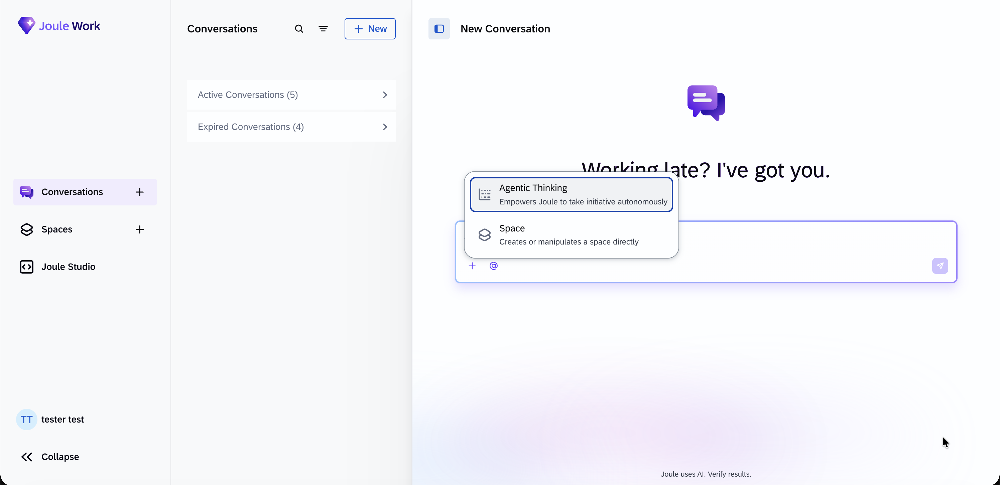

# Exercise 3 - Build a Joule Skill on the Golden Record

**Joule Work:** [https://747391938.eu10.sapdas.cloud.sap/new/conversations](https://747391938.eu10.sapdas.cloud.sap/new/conversations)

Log in with `XP267-201`.

In this exercise you ground **Joule** on the knowledge graph you built in the SAP BDC
Ontology Manager, which sits on top of the golden records from the earlier exercises. You import a
prepared **Joule skill** into Joule Work, turn it on, and ask customer-churn and delivery-performance
questions in a normal conversation.

> The skill (`ontology-manager-skill/`) is ready to use. Its connection to the Ontology Manager
> is wired through a **BTP destination** that the Joule runtime resolves for you — there are no
> credentials to paste and no code to edit. You import the folder, enable it, and start asking
> questions.

### Step 1 — Start an Agentic Thinking conversation

Click **New** to open a conversation. Once it opens, rename it to your user ID (for example, `XP267-250` if you got card 50) — click the conversation title at the top and type your ID. This makes it easy to find your session later.. **Before you type anything**, click the **`+`** at the bottom-left of the chat box and choose **Agentic Thinking** (*"Empowers Joule to take initiative
autonomously"*). Custom skills only run in an **Agentic Thinking** conversation — in a normal
conversation Joule can't reach the skill and will reply that the assistant is *"not available in
my current configuration,"* answering from general knowledge instead.



> You set this per conversation, before the first message. If you forget and Joule falls back to
> its training data, start a **new** conversation and select Agentic Thinking first.

---

### Step 2 — Connect the skill to the ontology

Start with a short message that points the skill at the ontology:

```text
@ontology-manager-skill use the Customer_Churn_Ontology_<your station number> to answer my questions.
```

Joule should confirm it's connected to the **Customer_Churn_Ontology_< your station number >** (you may see the ontology
name and its class count). On this first turn the skill pins the ontology and caches its schema,
then waits for your question.

> Lead with the explicit `@ontology-manager-skill` mention so Joule routes to the skill rather than
> inferring the topic. If it can't find the skill, re-check Step 5 (exactly one ontology skill
> active) and Step 6 (Agentic Thinking selected).

---

### Step 3 — Check that it reads from the governed data

Confirm Joule looks up the ontology before it answers. Paste this question:

```text
What data can you help me with? Use the Customer_Churn_Ontology_<your station number> — list it, then
describe what entities and attributes are available.
```

Joule should list the ontology and describe its entities — rather than answer from general
knowledge.

---


### Step 4 — Ask it to query the knowledge graph for real rows

Ask a question that forces the skill to run a SPARQL query against the knowledge graph:

```text
How many accounts are in each churn risk category?
```
The answer should list number of accounts in each churn risk category. 

---


### Step 5 — Ask question about to get insights about open support cases.

```text
How many open support cases are there in each status? Show me the breakdown.
```

The answer should show list of support cases by Status, Priority, Category  etc   to  helps gain insights into support workload, identify potential bottlenecks, and understand where cases may require attention based on their current status.

---


Additional Insight questions ( Optional ) : 


```text
Give me each sales opportunity with its current stage (e.g. Qualify, Propose), deal amount, and expected close date.
```

```text
Which accounts are rated "At Risk" for churn? For each, show its OTIF delivery
performance, renewal date, and NPS. Cite the account.
The answer should cite specific accounts with their OTIF, renewal date, and NPS pulled from the
graph.
```

```text
Rank the "At Risk" renewals by worst delivery performance, and tell me what each
one is costing — ACV at stake, days to renewal, and the delivery failures driving
the risk.
```


> The skill answers only from the knowledge graph: it looks up the ontology, reads its schema,
> and runs SPARQL, so every answer traces back to the governed data. The payoff is the churn ↔
> delivery link made actionable . When the data doesn't support an answer, the skill says so instead
> of guessing.


## What the skill does (for the curious)

The skill's behavior is defined entirely in `ontology-manager-skill/SKILL.md` — the instructions
Joule follows. Three rules in there are what make the answers trustworthy, and you can watch them
happen in the conversation:

1. **It grounds itself once, up front.** On the first turn it looks up the ontology, pins its
   UUID, and caches the schema — then stops and waits for your question. (This is the "ontology
   name and class count" confirmation you saw in Step 7.)
2. **It writes SPARQL from the real schema.** It reads the cached RDF/XML schema and builds each
   query from the actual class and property names in your ontology — it never invents field
   names.
3. **It never answers from memory.** Every value in an answer must come back from a live
   `execute_sparql` result. If the data doesn't support an answer, the skill says so instead of
   guessing — which is why the churn-risk answer in Step 10 traces back to real rows.

## How it connects (for the curious)

The skill is three files: `SKILL.md` (the instructions Joule follows — pin the ontology, cache
the schema, write SPARQL, never answer from memory), `scripts/ask_ontology_manager.py` (a thin client that
POSTs JSON-RPC to the Ontology Manager MCP server), and `.sap-connectivity.json` (which declares
a `destination` connector, `ONTOLOGY_MANAGER_TECHED_HANDSON_1`).

```
Joule Work conversation ──▶ ontology-manager-skill
                              │  scripts/ask_ontology_manager.py
                              │   • reads the proxy URL the runtime injects
                              ▼
         POST <proxy>/mcp-json/   (JSON-RPC: tools/call)
                              ▼
         BTP destination proxy (handles auth) ──▶ Ontology Manager MCP
                              ▼
                   SPARQL over the governed knowledge graph
```

At runtime the Joule platform reads `.sap-connectivity.json`, resolves the named destination, and
injects a proxy URL into the skill's environment (`API_ONTOLOGY_MANAGER_SKILL_AGENT`). The script
POSTs to that proxy and the **destination proxy attaches the credentials** — so no token ever
lives in the skill. The Ontology Manager turns the SPARQL into live queries over the
golden-record views. The MCP tools the skill uses are `list_ontologies`, `get_ontology_schema`,
and `execute_sparql` (plus `list_business_actions` / `execute_business_action` for triggering
actions).

## Summary

You grounded Joule on the governed knowledge graph built on your golden records — without
deploying anything or handling a single credential. Joule turns the churn ↔ delivery link into
an answer a renewals team can act on: at-risk accounts ranked by the OTIF failures driving their
risk, with the ACV at stake. Every answer is grounded in retrieved data and traces back through
the Ontology Manager to the underlying SAP data.

Return to - [Overview](../../README.md)
